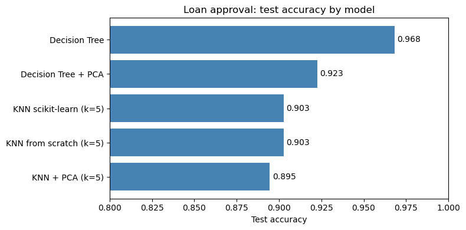
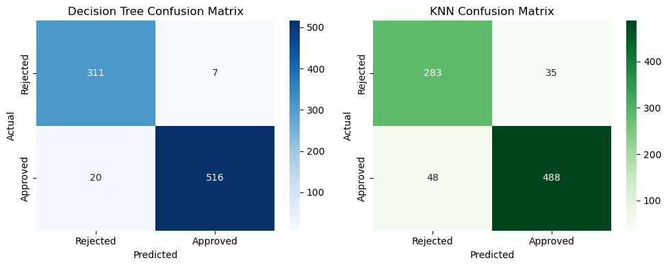

# Loan Approval Prediction

A machine learning project that predicts whether a loan application will be **approved or rejected** from the applicant's income, loan amount, CIBIL score, assets and other details. It compares a Decision Tree with a K-Nearest Neighbours classifier that I wrote from scratch, and measures what PCA does to each. Built in Python with scikit-learn.

[](https://colab.research.google.com/github/ziadelh/machine-learning-loan-approval/blob/main/loan_approval.ipynb)



| Model | Test accuracy |
|---|---|
| Decision Tree (max depth 5) | **96.8%** |
| Decision Tree + PCA | 92.3% |
| KNN from scratch (k=5) | 90.3% |
| KNN scikit-learn (k=5) | 90.3% |
| KNN + PCA | 89.5% |

Evaluated on a held-out 20% test split (854 applications).



## What it does

- **Cleaning:** strips stray whitespace in the categorical values, encodes them as 0/1, drops the ID column and standardises the numeric features
- **Decision Tree:** depth-limited tree with precision of 0.94 (rejected) and 0.99 (approved)
- **KNN from scratch:** Euclidean distance and majority vote, written without a library and checked against scikit-learn's `KNeighborsClassifier`, which gives the same result
- **PCA:** 5 components on the 8 numeric features, compared with and without for both models
- **Nested cross-validation:** the inner loop picks *k* for KNN, the outer loop estimates the accuracy of that whole procedure (91.3%)

## Dataset

[Loan Approval Prediction Dataset](https://www.kaggle.com/datasets/architsharma01/loan-approval-prediction-dataset) on Kaggle (MIT licence): 4,269 applications, 2,656 approved and 1,613 rejected. A copy is included in `data/`.

## Run

```bash
pip install pandas numpy scikit-learn seaborn matplotlib jupyter
jupyter notebook loan_approval.ipynb
```

Or use the **Open in Colab** button above, which loads the data from this repository.

## Tech Stack

Python · pandas · NumPy · scikit-learn · matplotlib · seaborn

## Author

Ziad Elhussein
